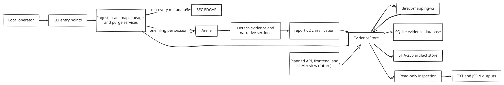

# Architecture

## Current system view



Source and rendered files:
- [Mermaid source](..\diagrams\sec-inline-financials-architecture.mmd)
- [Class SVG](../diagrams/sec-inline-financials-architecture.svg)
- [Class PNG](../diagrams/sec-inline-financials-architecture.png)
The architecture is a local evidence pipeline. Command-line entry points call  

application services. Those services own all SEC, Arelle, SQLite, and filesystem  

access. Reports and metric results are derived from retained evidence rather than  

used as a source of truth.

## Layers and responsibilities

| Layer | Components | Boundary |
| --- | --- | --- |
| User interface | Ingest, scan, map, lineage, and purge CLIs; inspection scripts | Argument parsing, explicit approvals, progress, exit codes |
| Application services | `CompanyIngestionService`, `EvidenceIngestionService`, `DirectMappingService`, `LineageMaintenanceService`, `CompanyDataPurger` | Coordinates use cases without embedding SEC/XBRL policy in the CLI |
| External adapters | `SecClient`, `ArelleProcessor`, SEC transform/retry plugins | Converts external SEC/Arelle behavior into detached domain records |
| Domain policy | extraction, section parsing, `report-v2`, mapping resolver, lineage graph, fingerprints | Deterministic and versioned decisions |
| Persistence | `EvidenceStore`, `EvidenceDatabase`, `ArtifactStore` | Short SQLite transactions and verified content-addressed files |
| Read models | report projection, TXT renderer, inspection tools | Rebuilds outputs from an exact snapshot/evaluation pair |

## Data flow

1. A CLI validates input and checks whether an existing database requires an  

explicitly approved migration.
2. Ingestion reads local state first. A complete, current company returns without  

SEC access.
3. A due or incomplete company is resolved through SEC submissions metadata. Its  

current CIK fills period slots before verified predecessor CIKs.
4. Each selected filing either reuses a verified compatible snapshot or opens one  

Arelle session.
5. The extractor copies filing-owned resources, detaches Arelle objects, parses  

required narrative sections, and computes source/profile/payload hashes.
6. `report-v2` classifies every observation. The store commits the complete  

snapshot, evidence graph, report decision set, and attempt status atomically.
7. Active annual and quarterly snapshot pointers are published only when the new  

successful window is stronger than the stored window.
8. When at least one new accession succeeded, Direct Mapping reads the published  

snapshots and `report-v2` decisions, writes one immutable metric evaluation per  

report kind, and updates the publication pointer.
9. Inspection tools later project TXT/JSON views from stored evidence without SEC  

or Arelle.
## Storage architecture

SQLite and the object store are one logical evidence store with different jobs:

- SQLite owns relationships, version identities, publication pointers,  

transactions, and bounded queries.
- The object store owns immutable source bytes and logs, addressed by SHA-256.
- Attempt-private staging directories isolate incomplete writes.
- Snapshot rows link the structured evidence graph to exact artifact identities.
- Active-window and published-metric tables act as mutable pointers; history stays  

immutable.
The store uses one writer at a time (`BEGIN IMMEDIATE`) and a busy timeout. It does  

not keep a database transaction open during SEC requests or Arelle processing.

## Trust boundaries

```
Operator input
    -> validated ticker/CIK/count/date arguments
SEC JSON and filing bytes
    -> shape checks, exact-form filters, pinned plugin hashes
Arelle object graph
    -> detached immutable records before Session closes
Stored artifacts
    -> path, size, and SHA-256 verification on reuse/read
SQLite publication
    -> foreign keys, cardinality checks, version/hash rechecks
```

The current program has no remote API server. A planned frontend must use a future  

backend API and must not query SQLite or the object store directly.

## Concurrency and failure model

- Companies and filings run sequentially. This respects Arelle's shared process  

state and keeps SQLite contention predictable.
- A filing failure is recorded on its attempt and does not undo other successful  

filings in the run.
- A failed SEC refresh may fall back to the prior published evidence.
- A mapping failure cannot roll back the evidence publication that preceded it.
- A lineage mutation commits before ingestion. A later ingestion failure leaves a  

valid, retryable lineage edge.
- Purge commits the relational deletion and pending-file queue before deleting  

files. Failed filesystem cleanup stays recoverable.
## Version boundaries

| Identity | Meaning |
| --- | --- |
| `evidence-v3` | Current serialized filing-evidence payload; includes registrant and archive-owner provenance. |
| `report-v2` | Current fact-classification policy; lineage context is included in its internal storage identity. |
| `report-v1` | Immutable historical classification identity retained for audit. |
| `target-metrics-v1` | Ordered definitions of the seven current metrics. |
| `direct-mapping-v2` | Current ordered concept-candidate policy. |

## Key trade-offs

1. **SQLite plus files instead of one blob store.** This gives relational queries  

and exact byte retention, at the cost of coordinated backup and purge logic.
2. **Immutable snapshots plus publication pointers.** This preserves audit history,  

at the cost of storage growth until the operator explicitly purges data.
3. **Sequential processing instead of threads.** This avoids Arelle global-state  

hazards and simplifies SQLite writes, at the cost of batch throughput.
4. **Explicit lineage instead of inference.** This prevents false company-history  

merges, at the cost of operator research and approval.
5. **Strict missing states instead of estimated values.** This keeps financial  

outputs defensible, at the cost of incomplete metric grids for unfamiliar tags.
6. **Mapping after successful new data only.** This avoids repeated work during  

current/no-update scans, while leaving the explicit mapping CLI available when  

an operator wants to rebuild or validate a complete stored window.
## Planned extension boundary

The blueprint plans a local backend API, browser frontend, and LLM-assisted mapping  

recommendations. Those layers should consume the existing bounded `EvidenceStore`  

read interfaces and immutable mapping inputs. They must not bypass publication  

pointers, invent metric values, or treat model output as approved mapping policy.

## Related documents

- [Software Design Description](software-design-description.md)
- [UML](uml.md)
- [Evidence storage design](designs/evidence-storage.md)
- [Ingestion and update design](designs/ingestAndUpdate.txt)