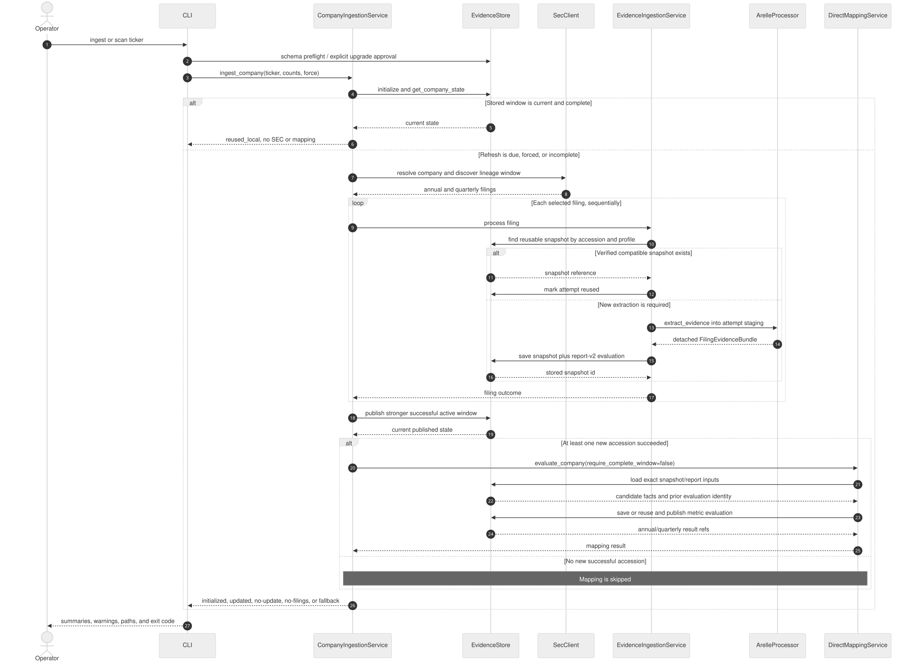

# UML

## Class diagram

Source and rendered files:
- [Mermaid source](..\diagrams\sec-inline-financials-class.mmd)
- [Class SVG](../diagrams/sec-inline-financials-class.svg)
- [Class PNG](../diagrams/sec-inline-financials-class.png)

The diagram focuses on stable service and aggregate boundaries rather than every
record type in the 3,000-line persistence module.

Key relationships:

- `CompanyIngestionService` is the use-case coordinator. It obtains discovery
  through `SecClient`, delegates filing work to `EvidenceIngestionService`,
  publishes through `EvidenceStore`, and invokes `DirectMappingService` only when
  successful new accessions exist.
- `EvidenceIngestionService` owns the per-filing attempt lifecycle. It either
  reuses a compatible snapshot or asks `ArelleProcessor` for a detached
  `FilingEvidenceBundle`.
- `EvidenceStore` is the persistence facade over `EvidenceDatabase` and
  `ArtifactStore`. Domain services do not execute storage SQL directly.
- `LineageMaintenanceService` and `CompanyDataPurger` use the same store but have
  separate approval and failure contracts.
- `FilingEvidenceBundle` contains the immutable filing evidence. A
  `ReportEvaluation` assigns roles to its observations; a
  `MetricWindowEvaluation` links target metrics back to selected stored facts.

## Ingest and refresh sequence

Source and rendered files:

- [Mermaid sequence source](../diagrams/sec-inline-financials-ingest-sequence.mmd)
- [Sequence SVG](../diagrams/sec-inline-financials-ingest-sequence.svg)
- [Sequence PNG](../diagrams/sec-inline-financials-ingest-sequence.png)

The sequence shows three important branches:

1. A current and complete company returns `reused_local` before an SEC client or
   Arelle processor is constructed.
2. Each selected filing independently reuses a verified snapshot or performs a
   new Arelle extraction and atomic snapshot save.
3. Direct Mapping runs after active-window publication only when at least one new
   accession was stored successfully. Current, empty, or unchanged checks skip it.

## UML scope and notation

Solid arrows show runtime calls or ownership. Dotted arrows show data production or
consumption. Composition marks records whose identity belongs to an aggregate even
when the normalized database stores their rows separately.

Mermaid class and sequence diagrams render to SVG and PNG, but the current offline
converter cannot make those diagram types editable as Excalidraw scenes. The system
architecture diagram is a flowchart and therefore includes an editable
`.excalidraw` file.

## Related documents

- [Software Design Description](software-design-description.md)
- [Architecture](architecture.md)

